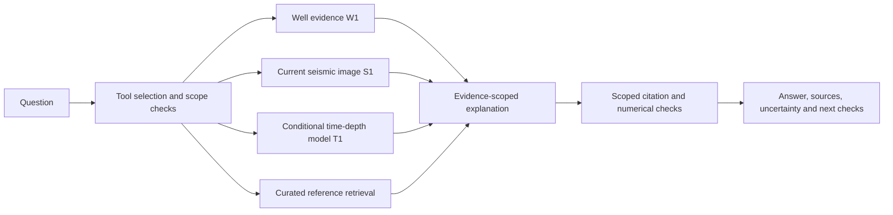

# GeoIntel Exploration Copilot

Challenge 1 prototype: a conversational assistant that assembles exploration
evidence, compares geological hypotheses, explains limitations, and recommends
the next investigation.

## Current capabilities

- Summarize explicit intervals from 13 supplied LAS wells.
- Group VSH and PHIT using unsupervised K-means; these are provisional property
  groups, not independently validated lithology classes.
- Review a loaded full-stack seismic section using a multimodal language model.
- Retrieve six curated public reference cards, including two illustrative field
  cases; this is not a full regional-report corpus or validated analogue search.
- Compare nearest-well and two-donor inverse-distance time-depth transfer using
  three source-well surveys and whole-well holdout tests.
- For the demonstrated eo-1 interval, use its configured MDKB reference and
  exported path to build conditional transferred time-depth estimates.
- Present calculated tables, source IDs W1/S1/T1, public links, limitations and
  recommendations in a Jupyter widget interface.

## Architecture



## Inputs and environment

Use the organizer-provided data inside the authorized HPC environment. LAS,
SEG-Y, well workbooks, exported surveys, fitted models and private checkpoints
are not distributed in this source copy. Configure the input paths and the
organizer's OpenAI-compatible model endpoint in the notebook. The endpoint must
support images for seismic review. The DUG environment already supplied the
working packages; requirements.txt records available package versions.

## Source and startup

The notebook contains the actual preparation/training source. Review the
generated source-review report and clean obsolete experimental calls in this
copy before a cold-start rehearsal. In particular, a failed cell may still
contain definitions used later: fix its failing call instead of deleting the
entire cell blindly. Helper-writing cells may contain obsolete versions.

The preparation sequence is: load and QC wells; split by well; fit the scaler
and K-means on training data; generate assignments; register well evidence;
load verified seismic metadata and one section; load public notes; import and
review source T/D surveys and the target path; build conditional candidates.
Keep the confirmed project depth reference distinct from unverified TWT datum
alignment. Once those notebook variables exist, the chat helpers are:

```python
%run -i "add_reference_library.py"
%run -i "add_seismic_tool.py"
%run -i "add_td_transfer_tool.py"
```

The private HPC checkpoint is a recovery aid, not a replacement for the source.
For the T/D-capable checkpoint use manage_td_session_v2.py. It saves and verifies
the data/model/tool state without serializing the API client or credentials.

## Demonstration

1. Summarize eo-1 from 2000 to 2200 m.
2. Compare nearest and IDW time-depth candidates for that interval.
3. Combine the interval with the currently loaded inline, compare structural,
   stratigraphic and imaging explanations, cite references, and recommend checks.
4. Compare Statfjord and East Texas as illustrative cases, with explicit missing
   evidence before calling either a prospect analogue.

## Validation and limits

Hold out whole wells, not randomly mixed adjacent log samples. Transfer errors
compare interpolated exported source curves, not measured error in eo-1.
Candidate agreement is not independent confirmation; the models share a donor.
Distance weights and retrieval scores are not confidence probabilities.

The current prototype does not establish a verified time-depth tie, independent
lithology classes, a closed trap, an effective seal, hydrocarbons or reserves.
The common TWT datum and seismic alignment remain unverified. Sonic and density
logs have not been found in the inspected LAS inventory, so no acoustic
synthetic-seismogram branch has been completed. Seismic observations require
geoscientist review. Hypothesis mapping on neighboring sections can proceed
while tie work continues.

## Submission status

This is a generated review copy. Outputs, attachments and saved widget state
were removed; source code was retained. The exporter did not execute the
cleaned notebook or certify reproducibility. Review the report, complete a
private cold-start check, add the team/repository details, and review source
for embedded data or credentials before publishing. No repository was created
or updated by the exporter.

## Repaired source copy: local configuration and runtime test

Run this notebook in a NEW kernel from this folder. The helper-writing cells and
historical checkpoint examples were disabled to preserve the packaged helpers
and require source reconstruction. Notebook preparation/model cells remain.
The LAS preview now reads the supplied eo-1 file and the path parser uses the
actual exported filename. The old manager filename now also supplies version 2.

The notebook reads GEOINTEL_MODEL_BASE_URL or geo_config.local.json. A local
configuration was prepared inside the HPC from the existing endpoint; keep it
private. For another authorized environment, copy geo_config.example.json to
geo_config.local.json and provide that environment's model URL. Model/API calls
can occur during notebook execution. Dependencies and organizer inputs must
already be available. Static syntax checks are not a successful runtime test.

The old review archive has not been updated. A final source archive should
exclude geo_config.local.json, data and runtime_state. Use the source packager
after the repaired notebook runs successfully; it does not copy JSON config.
